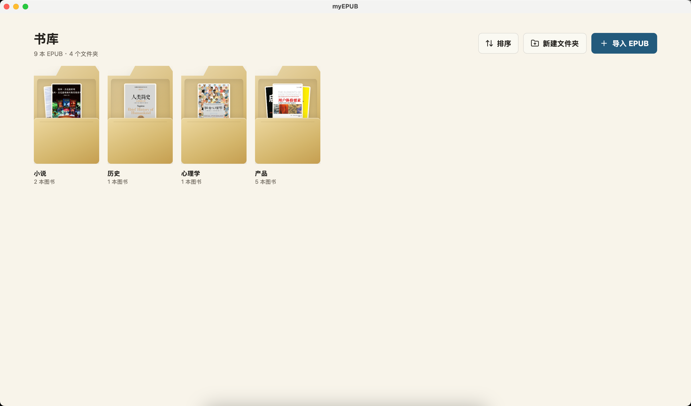
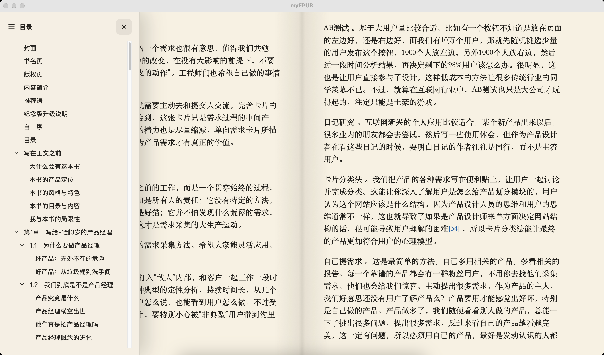
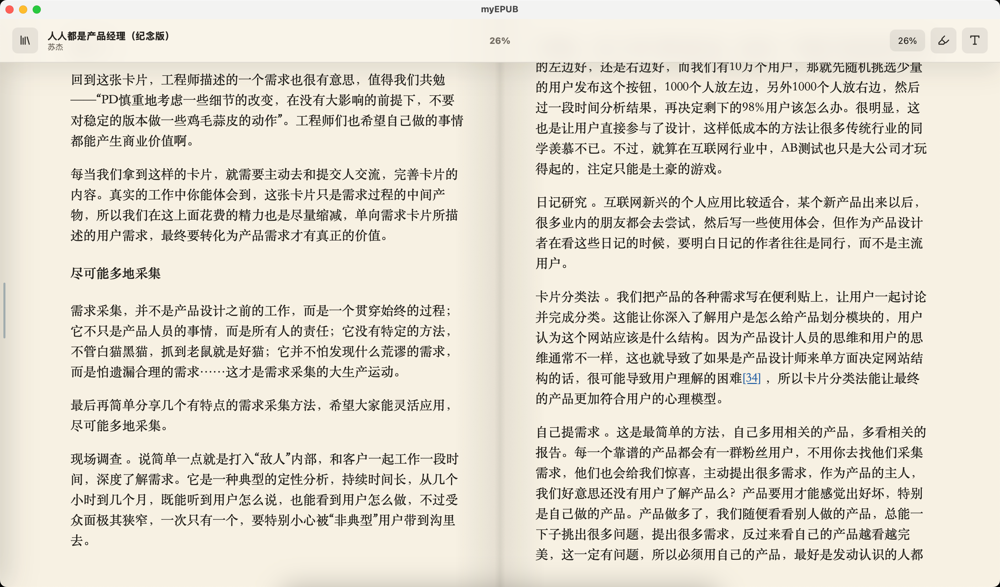
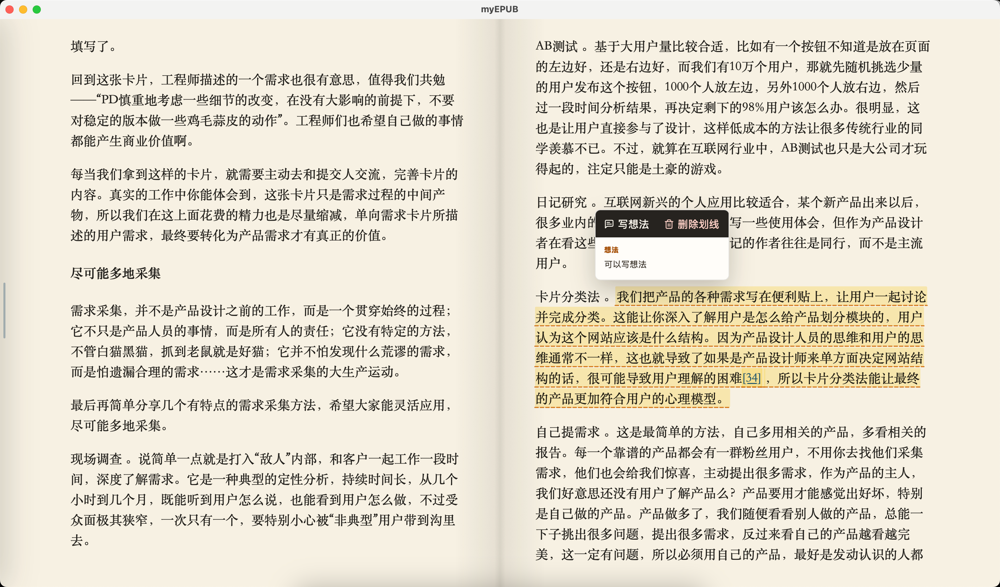

# myEPUB

myEPUB is a local desktop EPUB reader built with Tauri, React, and foliate-js.

## Screenshots

| Library and folders | Table of contents |
| --- | --- |
|  |  |

| Two-page reading | Highlights and notes |
| --- | --- |
|  |  |

## Download

For regular macOS users, download one of these packages from this repository:

- `release/myEPUB_0.1.0_mac_arm64_installer.dmg`

Open the DMG, then double-click `myEPUB Installer.pkg`.

Detailed Chinese installation instructions are included in `docs/INSTALL-macOS.md`.

## Compatibility

Current package:

- Version: `0.1.0`
- Platform: macOS
- Architecture: Apple Silicon, including M1, M2, M3, and M4 Macs
- Package type: unsigned PKG installer inside a DMG

This package is not notarized by Apple yet. On first launch, macOS may block it because it was downloaded from the internet. If that happens:

1. Open `System Settings`.
2. Go to `Privacy & Security`.
3. Find the blocked `myEPUB` message.
4. Choose `Open Anyway`.

Alternatively, right-click `myEPUB.app` and choose `Open`.

No developer tools are required for normal installation. Users do not need Node.js, Rust, Tauri, Xcode, or Git.

## Features

- Import and read local EPUB files.
- Keep books in a managed local storage folder.
- Resume the last app location and per-book reading progress.
- Organize books with custom folders and nested folders, including renaming and moving folders.
- Customize typography, theme, and reading background colors.
- Highlight text and save notes.
- Manually sort books and folders.

## Development

```sh
npm install
npm run dev
```

## Desktop Build

```sh
npm run desktop:build
```

The generated macOS app is located at:

```text
src-tauri/target/release/bundle/macos/myEPUB.app
```
